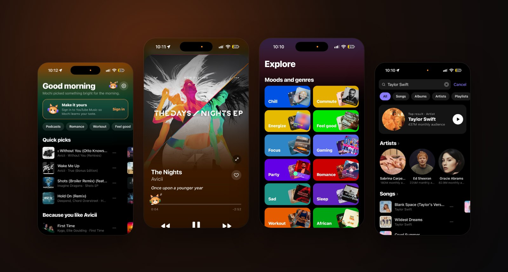
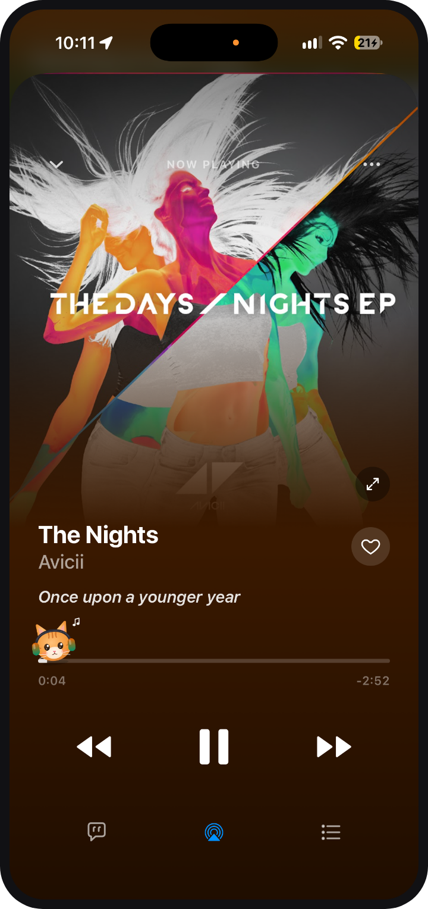
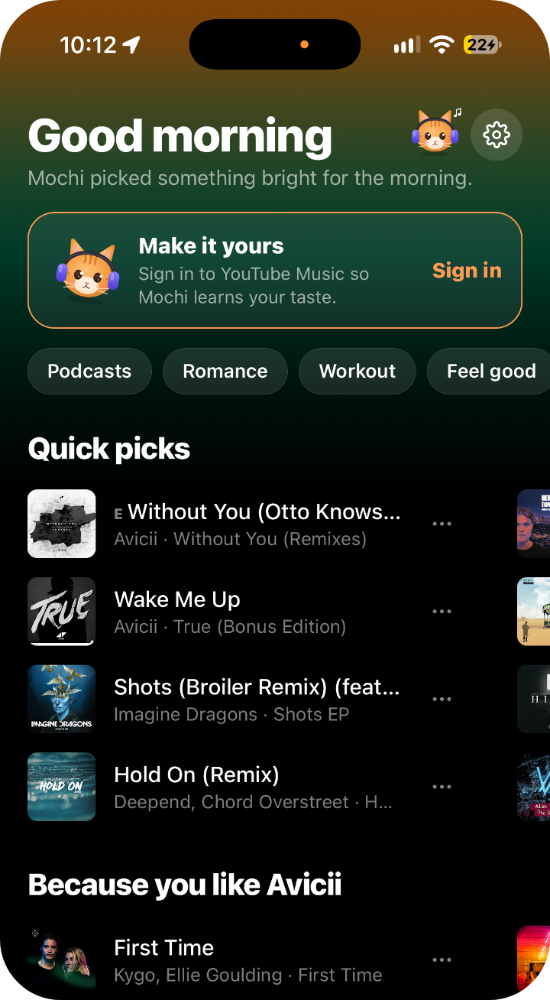
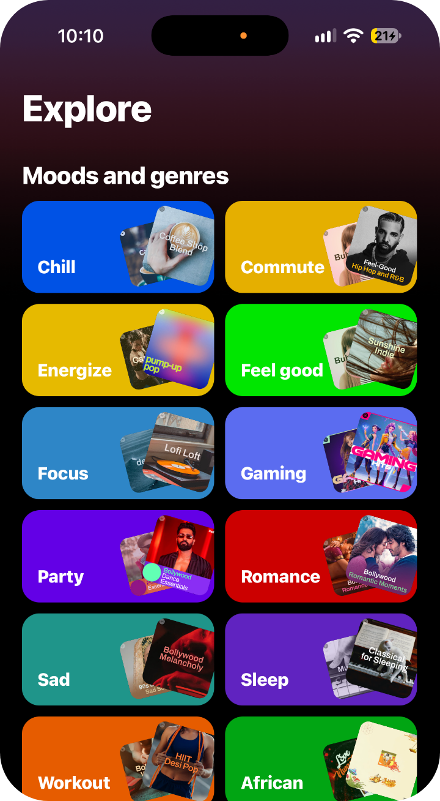
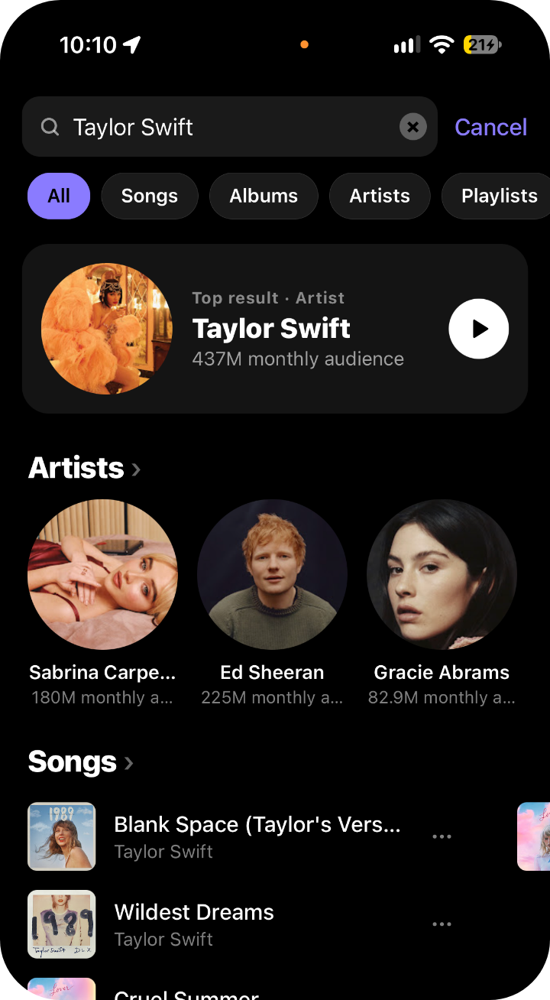
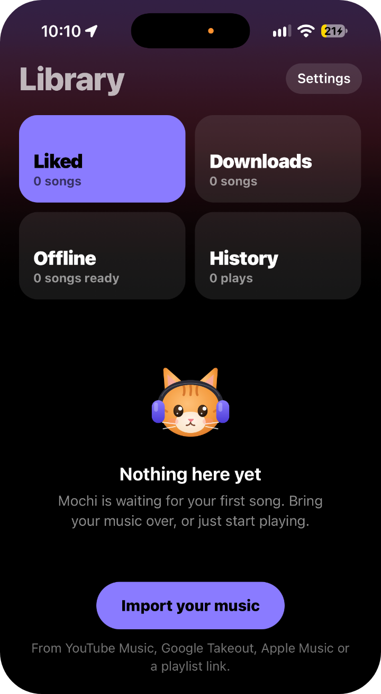
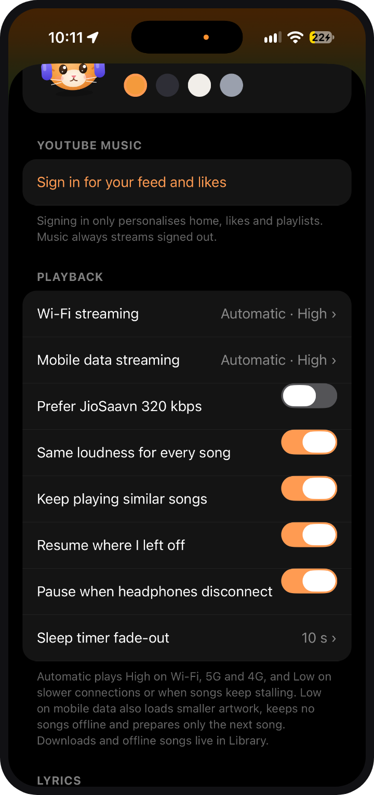
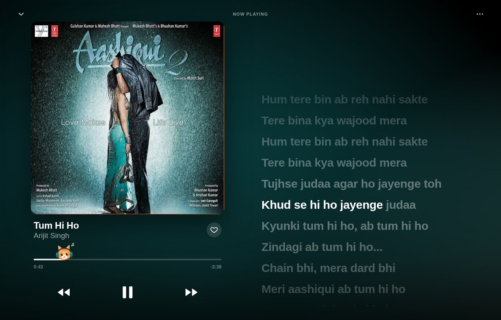

<p align="center">
  
</p>

<h1 align="center">Pawse</h1>

<p align="center">
  <b>A free music and video app for iPhone, Android, Mac, Windows and Linux. YouTube Music and YouTube without the noise, with a cat in your Dynamic Island.</b><br />
  <sub>Say it like "pause": a cat's paws, and the button you press on music.</sub>
</p>

<p align="center">
  <a href="https://github.com/thenetaji/pawse-music/releases/latest/download/Pawse.ipa"></a>
  <a href="https://github.com/thenetaji/pawse-music/releases/latest/download/Pawse.apk"></a>
  <br />
  <a href="https://github.com/thenetaji/pawse-music/releases/latest/download/Pawse-mac.dmg"></a>
  <a href="https://github.com/thenetaji/pawse-music/releases/latest/download/Pawse-Setup.exe"></a>
  <a href="https://github.com/thenetaji/pawse-music/releases/latest/download/Pawse-linux-x86_64.AppImage"></a>
</p>

<p align="center">
  <a href="https://github.com/thenetaji/pawse-music/releases/latest"></a>
  <a href="LICENSE"></a>
  
</p>

<p align="center">
  
</p>

## What it does

<table>
  <tr>
    <td align="center" width="33%"><br /><b>Big, beautiful player</b><br /><sub>The cover fills the screen. Lyrics follow along. Mochi dances on the progress bar.</sub></td>
    <td align="center" width="33%"><br /><b>Picks just for you</b><br /><sub>Quick picks and "Because you like…", learned on your phone. No sign-in needed.</sub></td>
    <td align="center" width="33%"><br /><b>Something for every mood</b><br /><sub>Chill, workout, focus, sleep, charts and new releases.</sub></td>
  </tr>
  <tr>
    <td align="center"><br /><b>All of YouTube Music</b><br /><sub>Songs, albums, artists and playlists, with radio from any song.</sub></td>
    <td align="center"><br /><b>Your library, your phone</b><br /><sub>Likes, playlists, downloads and offline songs. Bring yours over from YouTube Music or Apple Music.</sub></td>
    <td align="center"><br /><b>Made to your taste</b><br /><sub>Pick your cat, your colours and your sound quality.</sub></td>
  </tr>
</table>

Also: word-by-word lyrics, crossfade, a sleep timer, the same loudness for every song, songs that keep playing offline, and a little mouse that keeps teasing the cat.

### YouTube, without the noise

Turn on **Settings → Experimental → YouTube videos** and a **Watch** tab appears. It's YouTube the way you'd want it:

- **No Shorts, no ads, no mixes.** Your subscriptions when you're signed in, a feed when you're not, and video search.
- **A home you shape.** **Calm** stops the feed after one page; **Only my music** shows nothing suggested at all. Block channels, and words in titles, and they're gone everywhere.
- **Nothing plays by itself.** When a video ends you get Replay, Next or Done.
- **Keep watching while you browse.** Drag a video down and it keeps playing in the mini player above the tabs; tap it to bring it back.
- **Skips the boring parts.** Sponsor reads, self-promotion and "like and subscribe" are jumped over ([SponsorBlock](https://sponsor.ajay.app)), and so is the talking in music videos.
- **Honest titles and thumbnails** from [DeArrow](https://dearrow.ajay.app), without the all-caps clickbait. **Dislike counts** come back too ([Return YouTube Dislike](https://returnyoutubedislike.com)).
- **Every quality, or Auto.** 144p to 1080p60, or Auto, which follows your connection. Change it on any video without starting over.
- **Made for OLED.** The video fills the top of the screen and its picture glows softly onto true black, like YouTube's ambient mode.
- **Song | Video.** Flip the switch in the player and the song's video plays in place of the cover, in time with the music. **Listen** goes the other way, handing a video's sound to the music player. Full screen, picture in picture and background play work as usual.

<p align="center">
  <br />
  <sub>On a computer: the artwork on the left, lyrics that follow along on the right.</sub>
</p>

## Install

Pick your device below. Every release is on the [releases page](https://github.com/thenetaji/pawse-music/releases/latest).

### Which file do I need?

| File | For | Size |
| --- | --- | --- |
| [Pawse.ipa](https://github.com/thenetaji/pawse-music/releases/latest/download/Pawse.ipa) | iPhone. You install it with SideStore, AltStore or Sideloadly. | 24 MB |
| [Pawse.apk](https://github.com/thenetaji/pawse-music/releases/latest/download/Pawse.apk) | Android. One file for all phones. | 66 MB |
| [Pawse-mac.dmg](https://github.com/thenetaji/pawse-music/releases/latest/download/Pawse-mac.dmg) | Every Mac on macOS 12 or newer, Apple silicon and Intel. | 218 MB |
| [Pawse-Setup.exe](https://github.com/thenetaji/pawse-music/releases/latest/download/Pawse-Setup.exe) | Windows 10 and 11, on Intel, AMD and ARM (Snapdragon) PCs. | 207 MB |
| [Pawse-linux-amd64.deb](https://github.com/thenetaji/pawse-music/releases/latest/download/Pawse-linux-amd64.deb) | Ubuntu, Debian, Mint and Pop!_OS. | 95 MB |
| [Pawse-linux-x86_64.rpm](https://github.com/thenetaji/pawse-music/releases/latest/download/Pawse-linux-x86_64.rpm) | Fedora, RHEL and openSUSE. | 85 MB |
| [Pawse-linux-x86_64.AppImage](https://github.com/thenetaji/pawse-music/releases/latest/download/Pawse-linux-x86_64.AppImage) | Any other Linux. | 120 MB |

On an ARM Linux computer (Raspberry Pi 4 and 5 on 64-bit, ARM laptops), take the `arm64.deb`, `aarch64.rpm` or `arm64.AppImage` from the [releases page](https://github.com/thenetaji/pawse-music/releases/latest) instead.

Sizes are from version 1.0.2. The computer apps are big because each one carries its own copy of Chromium (they are built with Electron).

**One file per device.** Each release has one file for each kind of device, named the same every time (`Pawse.apk`, `Pawse.ipa` and so on). The version is in the release's title. Older versions stay on the [releases page](https://github.com/thenetaji/pawse-music/releases).

Not sure which Mac you have? Open the Apple menu, then **About This Mac**. If you see **Chip** (Apple M…), you have Apple silicon. If you see **Processor** (Intel…), you have an Intel Mac.

### iPhone
You need iOS 16.4 or newer. The Dynamic Island and the Lock Screen card need iOS 17 or newer.

Pawse installs through **SideStore**, which you set up once with a computer (it isn't on the App Store). Then, in SideStore, open **Sources** → **+** → paste this, and install **Pawse**:

```
https://raw.githubusercontent.com/thenetaji/pawse-music/main/sources/sidestore.json
```

**[The iPhone guide](docs/IPHONE.md)** walks through installing SideStore, the 7-day limit, and fixes for "Untrusted Developer", an app with a cloud icon and sign-in errors.

### Android
You need Android 7.0 or newer.

1. Download **[Pawse.apk](https://github.com/thenetaji/pawse-music/releases/latest/download/Pawse.apk)**.
2. Open it. If Android asks, allow your browser to **install unknown apps**.
3. If Play Protect warns you, tap **More details → Install anyway**.
4. Done. Pawse tells you when a new version is out. Updates install over the app, and your library stays.

**The cat pill around the camera.** In Pawse, go to **Settings → Android** and turn on the pill. Android asks for **Display over other apps**. Allow it for Pawse.

**Music stops in the background?** Some phones (Samsung, Xiaomi, Oppo, Vivo and others) close music and video apps to save battery. Open **Settings → Android → Keep playing in the background** and allow Pawse there.

### Mac
One file works on every Mac, Apple silicon and Intel, on macOS 12 or newer.

1. Download **[Pawse-mac.dmg](https://github.com/thenetaji/pawse-music/releases/latest/download/Pawse-mac.dmg)**.
2. Open it and drag **Pawse** into **Applications**.
3. The first time, macOS says it can't check the app. Open **System Settings → Privacy & Security**, scroll down and click **Open Anyway**. You only do this once.

If **Open Anyway** doesn't show up, open **Terminal**, run this, then open Pawse again:

```
xattr -dr com.apple.quarantine /Applications/Pawse.app
```

### Windows
1. Download **[Pawse-Setup.exe](https://github.com/thenetaji/pawse-music/releases/latest/download/Pawse-Setup.exe)** and open it.
2. If Windows shows "Windows protected your PC", click **More info → Run anyway**. You only do this once.
3. Pawse installs and opens. It's in the Start menu from then on.

To remove it, open **Settings → Apps → Installed apps**, find **Pawse** and click **Uninstall**.

### Linux
- **[.rpm](https://github.com/thenetaji/pawse-music/releases/latest/download/Pawse-linux-x86_64.rpm)** for Fedora, RHEL and openSUSE: `sudo dnf install ./Pawse-linux-x86_64.rpm` (openSUSE: `sudo zypper install ./Pawse-linux-x86_64.rpm`). To remove it: `sudo dnf remove pawse`.
- **[AppImage](https://github.com/thenetaji/pawse-music/releases/latest/download/Pawse-linux-x86_64.AppImage)**: make it executable (`chmod +x Pawse-linux-x86_64.AppImage`) and run it. On Ubuntu 22.04 and newer it also needs FUSE: `sudo apt install libfuse2` (on Ubuntu 24.04 the name is `libfuse2t64`, on Fedora `sudo dnf install fuse-libs`). To put it in your app menu, use [Gear Lever](https://flathub.org/apps/it.mijorus.gearlever).
- **[.deb](https://github.com/thenetaji/pawse-music/releases/latest/download/Pawse-linux-amd64.deb)** for Ubuntu, Debian, Mint and Pop!_OS: `sudo apt install ./Pawse-linux-amd64.deb`. To remove it: `sudo apt remove pawse`.

### On a computer
The keyboard works too: **Space** plays and pauses, **← →** jump 10 seconds, **Shift ← →** skip songs, **Ctrl/⌘ F** searches. Media keys and the system's Now Playing controls work as well.

Removing the app doesn't remove your library. For a clean uninstall, also delete the Pawse folder:

| System | Folder |
| --- | --- |
| Mac | `~/Library/Application Support/Pawse` |
| Windows | `%APPDATA%\Pawse` |
| Linux | `~/.config/Pawse` |

### Updates
- Pawse checks once a day and asks before updating. On a computer it opens the download page for the new version.
- Or open **Settings → About → Check for updates**.

## Keep your library safe

Open **Settings → Library → Back up library**. Pawse saves everything below into one file:

- your likes and playlists
- your play history (the last 1,000 plays, which is what your listening stats are made from)
- saved albums and followed artists
- your settings

Save the file somewhere safe, like Files or Google Drive. To get it all back, even on another phone, open **Settings → Library → Restore backup** and pick the file.

A backup does not hold:

- downloaded songs (download them again)
- your YouTube sign-in (sign in again)
- what Pawse has learned for your recommendations

Deleting the app deletes its data. Export first.

## Good to know

- **No account needed.** Signing in to YouTube is optional. It only brings your own home feed, likes, playlists and subscriptions. (Signing in is phone-only for now.)
- **Experimental means early.** YouTube videos and the features around them live in **Settings → Experimental** while they settle in. Turn them off and Pawse is a music player again.
- **Your data stays on your device.** No ads, no tracking, no Pawse servers. Your Google sign-in is kept in the iPhone Keychain or the Android Keystore.
- **Something wrong?** Open an [issue](https://github.com/thenetaji/pawse-music/issues/new/choose) and paste the log from **Settings → About → Diagnostics**.

<details>
<summary><b>For developers</b></summary>

- **Build it yourself:** [docs/BUILDING.md](docs/BUILDING.md)
- **Make a release:** [docs/RELEASING.md](docs/RELEASING.md)
- **Help out:** [CONTRIBUTING.md](CONTRIBUTING.md)

| Folder | What's inside |
| --- | --- |
| `apps/pawse` | The app: screens, the cat, the Dynamic Island and lock screen (`targets/`), native modules (`modules/`). |
| `apps/desktop` | The Mac, Windows and Linux app: the app's web build in an Electron window, with a small relay for YouTube, audio and video. |
| `packages/music-core` | Shared types for music, videos, streams and lyrics. |
| `packages/innertube` | YouTube Music, YouTube videos, JioSaavn, SponsorBlock, DeArrow and the lyrics sources. |
| `packages/player` | Playback: queue, radio, stream refresh, loudness, crossfade and segment skips. |
| `packages/config` | Shared TypeScript and lint settings. |

</details>

## Licence

Pawse is free and open source under the [GPL-3.0](LICENSE). It plays audio with [@rntp/player](https://rntp.dev), which is free for personal use only, so read [NOTICE.md](NOTICE.md) before you build something on top of it.

Pawse isn't affiliated with YouTube, Google, Apple, JioSaavn, SponsorBlock, DeArrow or Return YouTube Dislike. Please use it for your own listening and watching.

## Credits

YouTube playback follows [yt-dlp](https://github.com/yt-dlp/yt-dlp): its client list is synced from yt-dlp, and its [ejs](https://github.com/yt-dlp/ejs) solver (with meriyah and astring inside) is bundled. Videos play with [hls.js](https://github.com/video-dev/hls.js) on computers and [expo-video](https://github.com/expo/expo/tree/main/packages/expo-video) on phones. Skip segments and titles come from [SponsorBlock and DeArrow](https://sponsor.ajay.app), and dislike counts from [Return YouTube Dislike](https://returnyoutubedislike.com). Licences and links are in [NOTICE.md](NOTICE.md).

## Thanks

Pawse learned a lot from the open-source music apps before it: InnerTune, OuterTune, Metrolist, ViMusic and Echo Music, and from [YouTube.js](https://github.com/LuanRT/YouTube.js) and [ytmusicapi](https://github.com/sigma67/ytmusicapi). Lyrics come from [LRCLIB](https://lrclib.net), Lyrics+, BetterLyrics, KuGou and Unison.

<p align="center"><sub>Made with love by <a href="https://github.com/thenetaji">thenetaji</a> 🐾</sub></p>
